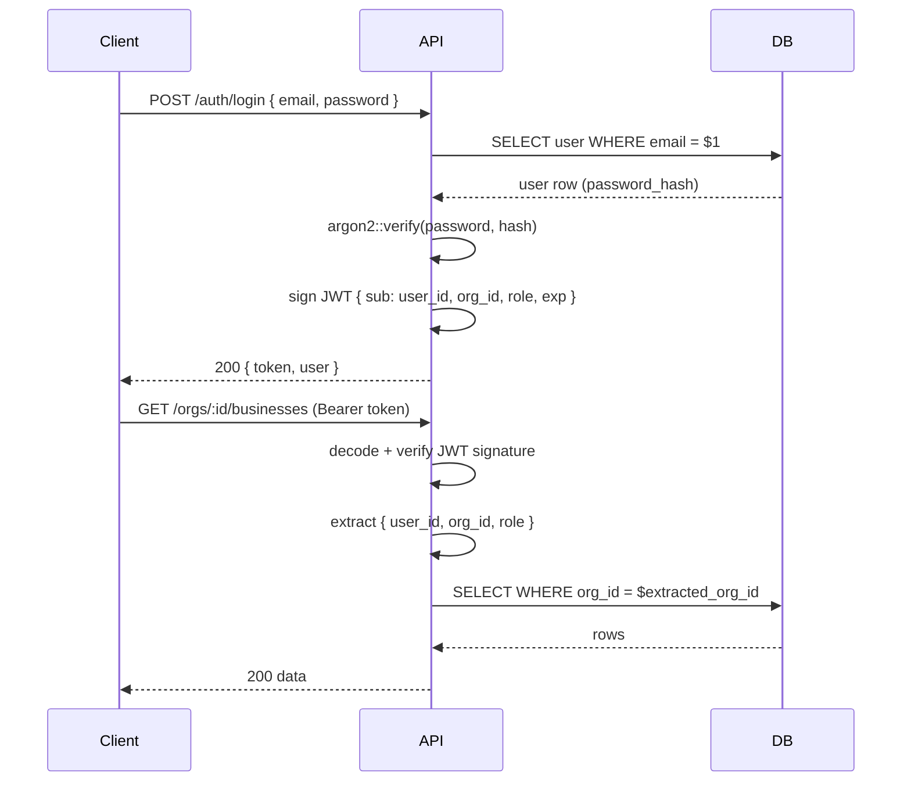

# OneTownCity — API Contract

> Version: 0.1.0 · Status: **Draft for Review** · Date: 2026-10-20

---

## 1. API Conventions

- **Base URL (dev):** `http://localhost:8080/api/v1`
- **Base URL (prod):** `https://api.onetowncity.com/api/v1`
- **Format:** JSON (`Content-Type: application/json`)
- **Authentication:** Bearer JWT in `Authorization: Bearer <token>` header
- **Pagination:** Cursor-based (`?after=<cursor>&limit=<n>`, default limit: 20, max: 100)
- **Errors:** Uniform envelope `{ "error": "message", "code": "ERROR_CODE" }`
- **Timestamps:** ISO 8601 UTC (`2026-10-20T09:00:00Z`)
- **IDs:** UUIDs as strings

### Standard Error Codes

| HTTP | code | Meaning |
|------|------|---------|
| 400 | `VALIDATION_ERROR` | Request body failed validation |
| 401 | `UNAUTHORIZED` | Missing or invalid JWT |
| 403 | `FORBIDDEN` | Authenticated but insufficient permission |
| 404 | `NOT_FOUND` | Resource does not exist |
| 409 | `CONFLICT` | Duplicate resource (e.g. email already exists) |
| 422 | `UNPROCESSABLE` | Business logic violation |
| 429 | `RATE_LIMITED` | Too many requests |
| 500 | `INTERNAL_ERROR` | Server error |

---

## 2. Authentication (`/api/v1/auth`)

### `POST /auth/register`
Create a new user account.

**Request:**
```json
{
  "name": "Jane Smith",
  "email": "jane@example.com",
  "password": "SecurePass123!"
}
```
**Response 201:**
```json
{
  "token": "<jwt>",
  "user": { "id": "uuid", "name": "Jane Smith", "email": "jane@example.com", "role": "consumer" }
}
```

### `POST /auth/login`
Authenticate and receive a JWT.

**Request:**
```json
{ "email": "jane@example.com", "password": "SecurePass123!" }
```
**Response 200:**
```json
{
  "token": "<jwt>",
  "user": { "id": "uuid", "name": "Jane Smith", "email": "jane@example.com", "role": "owner" }
}
```

### `POST /auth/magic-link`
Request a magic link sent to the email address.

**Request:** `{ "email": "jane@example.com" }`
**Response 202:** `{ "message": "Magic link sent if account exists" }` *(intentionally non-specific)*

### `GET /auth/me`
🔒 Auth required. Return the current authenticated user.

**Response 200:**
```json
{
  "id": "uuid", "name": "Jane Smith", "email": "jane@example.com",
  "role": "owner", "email_verified_at": "2026-10-01T10:00:00Z"
}
```

### `POST /auth/refresh`
Exchange a valid token for a new one (extend session).

---

## 3. Organisations (`/api/v1/orgs`)

All endpoints 🔒 require authentication.

### `POST /orgs`
Create a new organisation. Caller becomes `owner`.

**Request:** `{ "name": "Prajith's Plumbing" }`
**Response 201:** `{ "id": "uuid", "name": "Prajith's Plumbing", "slug": "prajiths-plumbing" }`

### `GET /orgs/:org_id`
Get organisation details (member must belong to org).

### `PATCH /orgs/:org_id`
🔒 `org_role: owner|admin`. Update org name.

### `GET /orgs/:org_id/members`
🔒 List all members of the organisation.

### `POST /orgs/:org_id/invite`
🔒 `org_role: owner|admin`. Invite a user by email.
**Request:** `{ "email": "team@example.com", "role": "member" }`

### `DELETE /orgs/:org_id/members/:user_id`
🔒 `org_role: owner`. Remove a member.

---

## 4. Business Profiles (`/api/v1/orgs/:org_id/businesses`)

### `GET /orgs/:org_id/businesses`
🔒 List all business profiles owned by the org.

### `POST /orgs/:org_id/businesses`
🔒 Create a new business profile.

**Request:**
```json
{
  "name": "Prajith's Plumbing",
  "primary_category_id": "uuid",
  "town_id": "uuid",
  "description": "Local plumbing services in Coventry.",
  "phone": "+44 7700 900000",
  "email": "hello@example.com",
  "website_url": "https://example.com",
  "address_line1": "12 High Street",
  "city": "Coventry",
  "postcode": "CV1 1AA",
  "country_code": "GB",
  "lat": 52.4068,
  "lng": -1.5197
}
```
**Response 201:** Full business profile object.

### `GET /orgs/:org_id/businesses/:business_id`
🔒 Get full profile (owner view, includes draft status).

### `PATCH /orgs/:org_id/businesses/:business_id`
🔒 Update any field. Partial update supported.

### `DELETE /orgs/:org_id/businesses/:business_id`
🔒 `org_role: owner`. Soft-delete the business profile.

### `POST /orgs/:org_id/businesses/:business_id/media/upload-url`
🔒 Generate a pre-signed R2 PUT URL for direct browser upload.

**Request:** `{ "filename": "shop-front.jpg", "content_type": "image/jpeg", "media_type": "photo" }`
**Response 200:** `{ "upload_url": "https://...", "asset_id": "uuid" }`

### `DELETE /orgs/:org_id/businesses/:business_id/media/:asset_id`
🔒 Delete a media asset (removes from R2 and database).

---

## 5. Public Discovery (`/api/v1/discovery`)

All endpoints are **public** (no auth required).

### `GET /discovery/businesses`
List businesses. Supports filtering and pagination.

**Query params:**
| Param | Type | Description |
|-------|------|-------------|
| `town` | string | Town slug |
| `category` | string | Category slug |
| `q` | string | Full-text search query |
| `lat`, `lng`, `radius_km` | float | Proximity filter |
| `open_now` | boolean | Filter by currently open |
| `sort` | string | `relevance` \| `rating` \| `newest` |
| `after` | string | Cursor for next page |
| `limit` | int | Results per page (default 20) |

**Response 200:**
```json
{
  "data": [
    {
      "id": "uuid",
      "name": "Prajith's Plumbing",
      "slug": "prajiths-plumbing",
      "category": { "id": "uuid", "name": "Plumbers", "slug": "plumbers" },
      "town": { "id": "uuid", "name": "Coventry", "slug": "coventry" },
      "description": "Local plumbing services...",
      "phone": "+44 7700 900000",
      "address": { "line1": "12 High Street", "city": "Coventry", "postcode": "CV1 1AA" },
      "is_verified": true,
      "average_rating": 4.8,
      "review_count": 12,
      "logo_url": "https://..."
    }
  ],
  "pagination": { "next_cursor": "abc123", "has_more": true }
}
```

### `GET /discovery/businesses/:slug`
Get a single public business profile.

**Response 200:** Full public profile including photos, opening hours, reviews summary, and review list.

### `GET /discovery/categories`
List all categories (hierarchical).

### `GET /discovery/towns`
List all towns with business counts.

### `GET /discovery/search`
Full-text search — alias for `GET /discovery/businesses?q=...`

---

## 6. Enquiries (`/api/v1/enquiries`)

### `POST /enquiries`
Public. Submit an enquiry to a business.

**Request:**
```json
{
  "business_id": "uuid",
  "sender_name": "John Consumer",
  "sender_email": "john@example.com",
  "sender_phone": "+44 7700 900001",
  "message": "Do you cover CV2 postcodes?"
}
```
**Response 201:** `{ "id": "uuid", "message": "Enquiry sent" }`

**Rate limit:** 5 enquiries per IP per hour.

### `GET /orgs/:org_id/businesses/:business_id/enquiries`
🔒 `org member`. List enquiries for a business (paginated).

**Query params:** `?status=new|read|replied|archived`

### `PATCH /orgs/:org_id/businesses/:business_id/enquiries/:enquiry_id`
🔒 Update enquiry status.
**Request:** `{ "status": "read" }`

---

## 7. Reviews (`/api/v1/reviews`)

### `POST /reviews`
🔒 `role: consumer`. Submit a review.

**Request:**
```json
{
  "business_id": "uuid",
  "rating": 5,
  "body": "Excellent service, came same day."
}
```
**Response 202:** `{ "id": "uuid", "status": "pending" }` *(awaiting admin approval)*

### `GET /discovery/businesses/:slug/reviews`
Public. List approved reviews for a business.

### `POST /orgs/:org_id/businesses/:business_id/reviews/:review_id/response`
🔒 `org member`. Post owner response to an approved review.

### `POST /reviews/:review_id/flag`
🔒 `org member`. Flag a review for admin moderation.

---

## 8. Analytics (`/api/v1/orgs/:org_id/businesses/:business_id/analytics`)

🔒 `org member`. Paid plans only (entitlement checked in handler).

### `GET /analytics/summary`
**Query params:** `?period=7d|30d|90d|12mo`

**Response 200:**
```json
{
  "profile_views": { "total": 342, "change_pct": 12.5 },
  "enquiries_sent": { "total": 18 },
  "phone_clicks": { "total": 24 },
  "website_clicks": { "total": 31 }
}
```

### `GET /analytics/events`
Raw event stream for charting. Returns daily aggregates.

---

## 9. Subscriptions (`/api/v1/orgs/:org_id/subscription`)

### `GET /orgs/:org_id/subscription`
🔒 `org_role: owner|admin`. Get current subscription details.

### `POST /orgs/:org_id/subscription/checkout`
🔒 `org_role: owner`. Create Stripe Checkout session.
**Request:** `{ "plan": "starter" }`
**Response 200:** `{ "checkout_url": "https://checkout.stripe.com/..." }`

### `POST /orgs/:org_id/subscription/portal`
🔒 `org_role: owner`. Create Stripe Customer Portal session.
**Response 200:** `{ "portal_url": "https://billing.stripe.com/..." }`

### `POST /webhooks/stripe`
**Public** (signature-verified). Receives Stripe events.
Handles: `customer.subscription.updated`, `customer.subscription.deleted`, `invoice.payment_failed`

---

## 10. Admin (`/api/v1/admin`)

🔒 `role: admin` required on all endpoints. Separate router with admin-check middleware.

### `GET /admin/businesses`
List all businesses with filters (`?status=draft|active|suspended`).

### `PATCH /admin/businesses/:business_id`
Update business status (`suspend`, `restore`, `verify`).

### `GET /admin/reviews`
List pending reviews awaiting moderation.

### `PATCH /admin/reviews/:review_id`
Approve or reject a review. `{ "status": "approved" | "rejected", "reason": "..." }`

### `GET /admin/categories`
List all categories.

### `POST /admin/categories`
Create a category.

### `PATCH /admin/categories/:category_id`
Update or reorder a category.

### `GET /admin/audit-log`
View audit log with filters.

---

## 11. Analytics Event Ingestion (`/api/v1/events`)

Lightweight endpoint for tracking public events (no auth — rate-limited by IP).

### `POST /events`
**Request:**
```json
{
  "business_id": "uuid",
  "event_type": "profile_view",
  "referrer": "https://google.com"
}
```
**Response 202:** Accepted. Written asynchronously.

> **Privacy note:** Session hash is computed server-side from HMAC(IP + User-Agent, server_secret). Raw IP is never stored.

---

## 12. Health and Meta

### `GET /health`
**Public.** Returns server status.
```json
{ "status": "ok", "service": "one_town_city", "db": "connected" }
```

### `GET /api/v1/ping`
**Public.** Returns `"pong"`.

---

## 13. Authentication Flow (JWT)



**JWT Claims:**
```json
{
  "sub": "user-uuid",
  "org_id": "org-uuid",
  "role": "owner",
  "org_role": "admin",
  "exp": 1761012261,
  "iat": 1761008661
}
```

> **Token lifetime:** 1 hour access token. Refresh flow TBD (sliding session or refresh token in `HttpOnly` cookie).

---

## 14. Versioning

- All routes are versioned under `/api/v1`.
- Breaking changes bump the version to `/api/v2`; old versions are maintained for a minimum 6-month deprecation window.
- Non-breaking additions (new fields, new endpoints) do not require a version bump.
