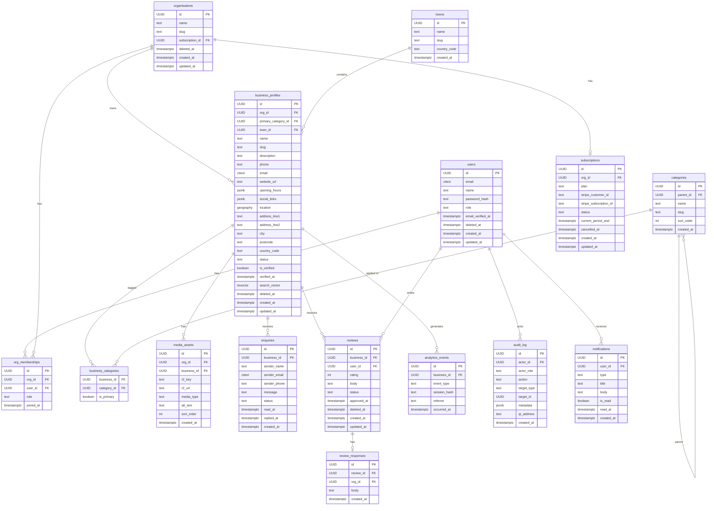

# OneTownCity — Database Design

> Version: 0.1.0 · Status: **Draft for Review** · Date: 2026-10-20

---

## 1. Design Principles

1. **UUIDs everywhere** — all primary keys use `UUID` (v4) generated in the database via `uuid_generate_v4()`. No sequential integer IDs exposed externally.
2. **Immutable audit trail** — the `audit_log` table is append-only; rows are never updated or deleted.
3. **Soft deletes for business data** — business profiles, users, and reviews use `deleted_at TIMESTAMPTZ` rather than hard deletes, to support GDPR export-then-delete workflows.
4. **Tenant isolation enforced at query level** — every org-scoped table has `org_id UUID NOT NULL` and all queries filter on it.
5. **Updated-at triggers** — a shared PL/pgSQL trigger function automatically maintains `updated_at` on all mutable tables.
6. **Full-text search via generated columns** — `tsvector` generated columns are maintained by PostgreSQL; `GIN` indexes cover them.
7. **PostGIS for proximity** — `geography(Point, 4326)` type on business address; requires `CREATE EXTENSION postgis`.
8. **No JSON blobs for structured data** — `JSONB` is used only for flexible attributes (hours, social links); core relational data uses typed columns.

---

## 2. Extensions Required

```sql
CREATE EXTENSION IF NOT EXISTS "uuid-ossp";   -- UUID generation
CREATE EXTENSION IF NOT EXISTS "postgis";      -- Geographic types and functions
CREATE EXTENSION IF NOT EXISTS "pg_trgm";     -- Trigram fuzzy search (optional, for autocomplete)
CREATE EXTENSION IF NOT EXISTS "citext";      -- Case-insensitive text (email)
```

---

## 3. Entity Relationship Diagram



---

## 4. Table Definitions

### 4.1 `users`

```sql
CREATE TABLE users (
    id                  UUID PRIMARY KEY DEFAULT uuid_generate_v4(),
    email               CITEXT UNIQUE NOT NULL,
    name                TEXT NOT NULL,
    password_hash       TEXT,                          -- NULL for OAuth-only accounts
    role                TEXT NOT NULL DEFAULT 'consumer'
                            CHECK (role IN ('consumer', 'owner', 'admin')),
    email_verified_at   TIMESTAMPTZ,
    deleted_at          TIMESTAMPTZ,
    created_at          TIMESTAMPTZ NOT NULL DEFAULT NOW(),
    updated_at          TIMESTAMPTZ NOT NULL DEFAULT NOW()
);

CREATE INDEX idx_users_email ON users (email);
CREATE INDEX idx_users_role  ON users (role);
```

### 4.2 `organisations`

```sql
CREATE TABLE organisations (
    id          UUID PRIMARY KEY DEFAULT uuid_generate_v4(),
    name        TEXT NOT NULL,
    slug        TEXT UNIQUE NOT NULL,
    deleted_at  TIMESTAMPTZ,
    created_at  TIMESTAMPTZ NOT NULL DEFAULT NOW(),
    updated_at  TIMESTAMPTZ NOT NULL DEFAULT NOW()
);
```

### 4.3 `org_memberships`

```sql
CREATE TABLE org_memberships (
    id          UUID PRIMARY KEY DEFAULT uuid_generate_v4(),
    org_id      UUID NOT NULL REFERENCES organisations(id) ON DELETE CASCADE,
    user_id     UUID NOT NULL REFERENCES users(id) ON DELETE CASCADE,
    role        TEXT NOT NULL DEFAULT 'member'
                    CHECK (role IN ('owner', 'admin', 'member')),
    joined_at   TIMESTAMPTZ NOT NULL DEFAULT NOW(),
    UNIQUE (org_id, user_id)
);

CREATE INDEX idx_org_memberships_user ON org_memberships (user_id);
CREATE INDEX idx_org_memberships_org  ON org_memberships (org_id);
```

### 4.4 `categories`

```sql
CREATE TABLE categories (
    id          UUID PRIMARY KEY DEFAULT uuid_generate_v4(),
    parent_id   UUID REFERENCES categories(id) ON DELETE SET NULL,
    name        TEXT NOT NULL,
    slug        TEXT UNIQUE NOT NULL,
    sort_order  INT NOT NULL DEFAULT 0,
    created_at  TIMESTAMPTZ NOT NULL DEFAULT NOW()
);

CREATE INDEX idx_categories_parent ON categories (parent_id);
CREATE INDEX idx_categories_slug   ON categories (slug);
```

### 4.5 `towns`

```sql
CREATE TABLE towns (
    id              UUID PRIMARY KEY DEFAULT uuid_generate_v4(),
    name            TEXT NOT NULL,
    slug            TEXT UNIQUE NOT NULL,
    country_code    TEXT NOT NULL DEFAULT 'GB',
    created_at      TIMESTAMPTZ NOT NULL DEFAULT NOW()
);

CREATE INDEX idx_towns_slug ON towns (slug);
```

### 4.6 `business_profiles`

```sql
CREATE TABLE business_profiles (
    id                  UUID PRIMARY KEY DEFAULT uuid_generate_v4(),
    org_id              UUID NOT NULL REFERENCES organisations(id) ON DELETE CASCADE,
    primary_category_id UUID REFERENCES categories(id) ON DELETE SET NULL,
    town_id             UUID REFERENCES towns(id) ON DELETE SET NULL,

    -- Identity
    name                TEXT NOT NULL,
    slug                TEXT UNIQUE NOT NULL,
    description         TEXT,
    phone               TEXT,
    email               CITEXT,
    website_url         TEXT,

    -- Address
    address_line1       TEXT,
    address_line2       TEXT,
    city                TEXT,
    postcode            TEXT,
    country_code        TEXT NOT NULL DEFAULT 'GB',
    location            GEOGRAPHY(Point, 4326),        -- PostGIS lat/lng

    -- Flexible structured data
    opening_hours       JSONB,   -- { "mon": { "open": "09:00", "close": "17:00" }, ... }
    social_links        JSONB,   -- { "facebook": "url", "instagram": "url" }

    -- Status
    status              TEXT NOT NULL DEFAULT 'active'
                            CHECK (status IN ('draft', 'active', 'suspended', 'deleted')),
    is_verified         BOOLEAN NOT NULL DEFAULT FALSE,
    verified_at         TIMESTAMPTZ,

    -- Full-text search
    search_vector       TSVECTOR GENERATED ALWAYS AS (
                            setweight(to_tsvector('english', coalesce(name, '')), 'A') ||
                            setweight(to_tsvector('english', coalesce(description, '')), 'B') ||
                            setweight(to_tsvector('english', coalesce(city, '')), 'C')
                        ) STORED,

    deleted_at          TIMESTAMPTZ,
    created_at          TIMESTAMPTZ NOT NULL DEFAULT NOW(),
    updated_at          TIMESTAMPTZ NOT NULL DEFAULT NOW()
);

-- Indexes
CREATE INDEX idx_bp_org_id        ON business_profiles (org_id);
CREATE INDEX idx_bp_town_id       ON business_profiles (town_id);
CREATE INDEX idx_bp_category_id   ON business_profiles (primary_category_id);
CREATE INDEX idx_bp_slug          ON business_profiles (slug);
CREATE INDEX idx_bp_status        ON business_profiles (status) WHERE deleted_at IS NULL;
CREATE INDEX idx_bp_search_vector ON business_profiles USING GIN (search_vector);
CREATE INDEX idx_bp_location      ON business_profiles USING GIST (location);
```

### 4.7 `business_categories`

```sql
CREATE TABLE business_categories (
    business_id     UUID NOT NULL REFERENCES business_profiles(id) ON DELETE CASCADE,
    category_id     UUID NOT NULL REFERENCES categories(id) ON DELETE CASCADE,
    is_primary      BOOLEAN NOT NULL DEFAULT FALSE,
    PRIMARY KEY (business_id, category_id)
);

CREATE INDEX idx_bc_category ON business_categories (category_id);
```

### 4.8 `media_assets`

```sql
CREATE TABLE media_assets (
    id              UUID PRIMARY KEY DEFAULT uuid_generate_v4(),
    org_id          UUID NOT NULL REFERENCES organisations(id) ON DELETE CASCADE,
    business_id     UUID NOT NULL REFERENCES business_profiles(id) ON DELETE CASCADE,
    r2_key          TEXT NOT NULL UNIQUE,    -- R2 object key
    r2_url          TEXT NOT NULL,           -- Public CDN URL
    media_type      TEXT NOT NULL DEFAULT 'photo'
                        CHECK (media_type IN ('photo', 'logo', 'cover', 'document')),
    alt_text        TEXT,
    sort_order      INT NOT NULL DEFAULT 0,
    created_at      TIMESTAMPTZ NOT NULL DEFAULT NOW()
);

CREATE INDEX idx_media_business ON media_assets (business_id);
CREATE INDEX idx_media_org      ON media_assets (org_id);
```

### 4.9 `enquiries`

```sql
CREATE TABLE enquiries (
    id              UUID PRIMARY KEY DEFAULT uuid_generate_v4(),
    business_id     UUID NOT NULL REFERENCES business_profiles(id) ON DELETE CASCADE,
    sender_name     TEXT NOT NULL,
    sender_email    CITEXT NOT NULL,
    sender_phone    TEXT,
    message         TEXT NOT NULL,
    status          TEXT NOT NULL DEFAULT 'new'
                        CHECK (status IN ('new', 'read', 'replied', 'archived')),
    read_at         TIMESTAMPTZ,
    replied_at      TIMESTAMPTZ,
    created_at      TIMESTAMPTZ NOT NULL DEFAULT NOW()
);

CREATE INDEX idx_enquiries_business ON enquiries (business_id, created_at DESC);
CREATE INDEX idx_enquiries_status   ON enquiries (status);
```

### 4.10 `reviews`

```sql
CREATE TABLE reviews (
    id              UUID PRIMARY KEY DEFAULT uuid_generate_v4(),
    business_id     UUID NOT NULL REFERENCES business_profiles(id) ON DELETE CASCADE,
    user_id         UUID NOT NULL REFERENCES users(id) ON DELETE SET NULL,
    rating          SMALLINT NOT NULL CHECK (rating BETWEEN 1 AND 5),
    body            TEXT NOT NULL,
    status          TEXT NOT NULL DEFAULT 'pending'
                        CHECK (status IN ('pending', 'approved', 'rejected')),
    approved_at     TIMESTAMPTZ,
    deleted_at      TIMESTAMPTZ,
    created_at      TIMESTAMPTZ NOT NULL DEFAULT NOW(),
    updated_at      TIMESTAMPTZ NOT NULL DEFAULT NOW(),
    UNIQUE (business_id, user_id)   -- One review per consumer per business
);

CREATE INDEX idx_reviews_business ON reviews (business_id) WHERE status = 'approved';
CREATE INDEX idx_reviews_user     ON reviews (user_id);
```

### 4.11 `review_responses`

```sql
CREATE TABLE review_responses (
    id          UUID PRIMARY KEY DEFAULT uuid_generate_v4(),
    review_id   UUID NOT NULL UNIQUE REFERENCES reviews(id) ON DELETE CASCADE,
    org_id      UUID NOT NULL REFERENCES organisations(id) ON DELETE CASCADE,
    body        TEXT NOT NULL,
    created_at  TIMESTAMPTZ NOT NULL DEFAULT NOW()
);
```

### 4.12 `subscriptions`

```sql
CREATE TABLE subscriptions (
    id                      UUID PRIMARY KEY DEFAULT uuid_generate_v4(),
    org_id                  UUID NOT NULL UNIQUE REFERENCES organisations(id) ON DELETE CASCADE,
    plan                    TEXT NOT NULL DEFAULT 'free'
                                CHECK (plan IN ('free', 'starter', 'growth')),
    stripe_customer_id      TEXT UNIQUE,
    stripe_subscription_id  TEXT UNIQUE,
    status                  TEXT NOT NULL DEFAULT 'active'
                                CHECK (status IN ('active', 'past_due', 'cancelled', 'trialing')),
    current_period_end      TIMESTAMPTZ,
    cancelled_at            TIMESTAMPTZ,
    created_at              TIMESTAMPTZ NOT NULL DEFAULT NOW(),
    updated_at              TIMESTAMPTZ NOT NULL DEFAULT NOW()
);

CREATE INDEX idx_subscriptions_org    ON subscriptions (org_id);
CREATE INDEX idx_subscriptions_stripe ON subscriptions (stripe_subscription_id);
```

### 4.13 `analytics_events`

```sql
CREATE TABLE analytics_events (
    id              UUID PRIMARY KEY DEFAULT uuid_generate_v4(),
    business_id     UUID NOT NULL REFERENCES business_profiles(id) ON DELETE CASCADE,
    event_type      TEXT NOT NULL
                        CHECK (event_type IN ('profile_view', 'phone_click', 'website_click',
                                              'directions_click', 'enquiry_sent', 'search_appearance')),
    session_hash    TEXT,    -- hashed IP+UA to count uniques without storing PII
    referrer        TEXT,
    occurred_at     TIMESTAMPTZ NOT NULL DEFAULT NOW()
);

-- Partial index for time-range queries — recent data only hot path
CREATE INDEX idx_analytics_business_time ON analytics_events (business_id, occurred_at DESC);
CREATE INDEX idx_analytics_event_type    ON analytics_events (event_type, occurred_at DESC);
```

> **Retention:** Analytics events older than 13 months will be purged or archived via a scheduled job to control table size.

### 4.14 `audit_log`

```sql
CREATE TABLE audit_log (
    id              UUID PRIMARY KEY DEFAULT uuid_generate_v4(),
    actor_id        UUID REFERENCES users(id) ON DELETE SET NULL,
    actor_role      TEXT NOT NULL,
    action          TEXT NOT NULL,          -- e.g. 'business.suspend', 'review.reject', 'user.impersonate'
    target_type     TEXT NOT NULL,          -- e.g. 'business_profile', 'review', 'user'
    target_id       UUID,
    metadata        JSONB,                  -- context-specific payload
    ip_address      INET,
    created_at      TIMESTAMPTZ NOT NULL DEFAULT NOW()
);

CREATE INDEX idx_audit_actor  ON audit_log (actor_id, created_at DESC);
CREATE INDEX idx_audit_target ON audit_log (target_type, target_id, created_at DESC);
```

### 4.15 `notifications`

```sql
CREATE TABLE notifications (
    id          UUID PRIMARY KEY DEFAULT uuid_generate_v4(),
    user_id     UUID NOT NULL REFERENCES users(id) ON DELETE CASCADE,
    type        TEXT NOT NULL,      -- 'new_enquiry', 'new_review', 'subscription_event'
    title       TEXT NOT NULL,
    body        TEXT NOT NULL,
    is_read     BOOLEAN NOT NULL DEFAULT FALSE,
    read_at     TIMESTAMPTZ,
    created_at  TIMESTAMPTZ NOT NULL DEFAULT NOW()
);

CREATE INDEX idx_notifications_user ON notifications (user_id, is_read, created_at DESC);
```

---

## 5. Shared Trigger Function

```sql
CREATE OR REPLACE FUNCTION set_updated_at()
RETURNS TRIGGER AS $$
BEGIN
    NEW.updated_at = NOW();
    RETURN NEW;
END;
$$ LANGUAGE plpgsql;

-- Apply to all mutable tables:
CREATE TRIGGER trg_users_updated_at
    BEFORE UPDATE ON users FOR EACH ROW EXECUTE FUNCTION set_updated_at();
CREATE TRIGGER trg_organisations_updated_at
    BEFORE UPDATE ON organisations FOR EACH ROW EXECUTE FUNCTION set_updated_at();
CREATE TRIGGER trg_business_profiles_updated_at
    BEFORE UPDATE ON business_profiles FOR EACH ROW EXECUTE FUNCTION set_updated_at();
CREATE TRIGGER trg_reviews_updated_at
    BEFORE UPDATE ON reviews FOR EACH ROW EXECUTE FUNCTION set_updated_at();
CREATE TRIGGER trg_subscriptions_updated_at
    BEFORE UPDATE ON subscriptions FOR EACH ROW EXECUTE FUNCTION set_updated_at();
```

---

## 6. Aggregated Rating View

Rather than computing aggregate ratings on every query, maintain a materialised summary:

```sql
CREATE MATERIALIZED VIEW business_rating_summary AS
SELECT
    business_id,
    COUNT(*)                        AS review_count,
    ROUND(AVG(rating)::numeric, 1)  AS average_rating
FROM reviews
WHERE status = 'approved' AND deleted_at IS NULL
GROUP BY business_id;

CREATE UNIQUE INDEX ON business_rating_summary (business_id);

-- Refresh after review approval:
-- REFRESH MATERIALIZED VIEW CONCURRENTLY business_rating_summary;
```

---

## 7. Migration Plan

| Migration file | Contents |
|---------------|----------|
| `000001_init.sql` | Extensions, `set_updated_at` trigger function |
| `000002_users.sql` | `users` table |
| `000003_organisations.sql` | `organisations`, `org_memberships` |
| `000004_taxonomy.sql` | `categories`, `towns` |
| `000005_business_profiles.sql` | `business_profiles`, `business_categories` |
| `000006_media.sql` | `media_assets` |
| `000007_enquiries.sql` | `enquiries` |
| `000008_reviews.sql` | `reviews`, `review_responses`, rating view |
| `000009_subscriptions.sql` | `subscriptions` |
| `000010_analytics.sql` | `analytics_events` |
| `000011_audit_notifications.sql` | `audit_log`, `notifications` |

> **Note:** The current `20261020_000001_init.sql` migration contains an incomplete `users` and `towns` schema that does not match this design. It must be replaced (not updated) with the above migration sequence before any data is written to a shared environment.

---

## 8. Open Database Questions

| # | Question |
|---|----------|
| DQ1 | Which managed PostgreSQL provider? (Neon, Supabase, RDS) — affects PostGIS availability |
| DQ2 | Is `citext` extension available on the chosen provider? |
| DQ3 | Will `analytics_events` use table partitioning by month for scale? |
| DQ4 | Is a separate read replica needed for analytics queries in v1? |
| DQ5 | Should business slugs be globally unique or scoped to `town_slug + category_slug + name_slug`? |
