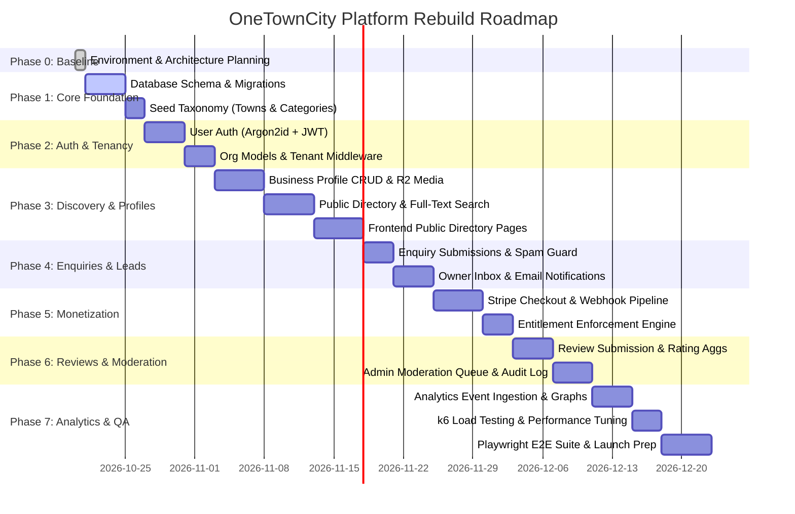
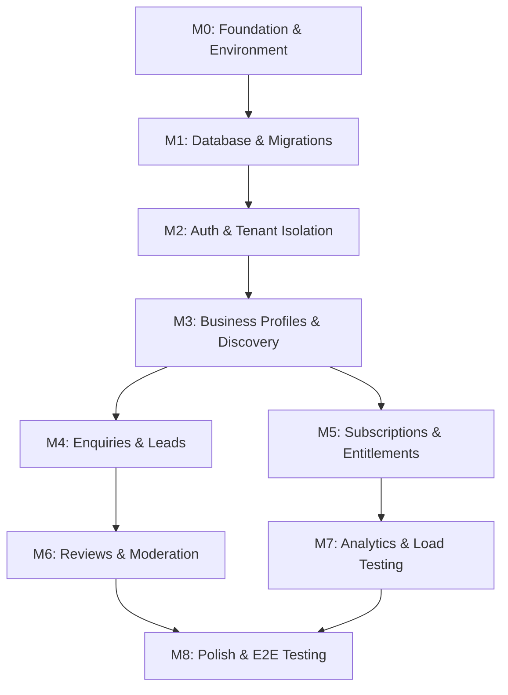

# OneTownCity — Implementation Roadmap & Execution Plan

> Version: 0.1.0 · Status: **Draft for Review** · Author: Technical Project Management · Date: 2026-10-20

---

## 1. Project Phase Overview

---

## 2. Detailed Milestones & Acceptance Criteria

### Milestone 0: Foundation & Environment Verification (Current State)
- **Objective:** Establish reproducible WSL2 local environment, CI configuration, and architecture plans.
- **Status:** **Completed ✅**
- **Artifacts:**
  - `docs/PRODUCT_REQUIREMENTS.md`
  - `docs/SYSTEM_ARCHITECTURE.md`
  - `docs/DATABASE_DESIGN.md`
  - `docs/API_CONTRACT.md`
  - `docs/SECURITY_MODEL.md`
  - `docs/MIGRATION_AND_DEPLOYMENT.md`
  - `docs/IMPLEMENTATION_ROADMAP.md`
  - Base project scaffolds for Next.js App Router and Rust Axum binary.
  - Sentry + OpenTelemetry initialization stubs.

---

### Milestone 1: Database Migration & Core Taxonomy
- **Objective:** Deploy production-grade schema across 11 migrations and seed initial taxonomy.
- **Tasks:**
  1. Replace `backend/migrations/20261020_000001_init.sql` with clean migration series (extensions, users, orgs, towns, categories, businesses, media, enquiries, reviews, subscriptions, analytics, audit).
  2. Implement PostGIS and full-text search `tsvector` generated columns and GIN indexes.
  3. Create seed script for UK standard towns and hierarchical business categories (e.g., Trades & Home, Food & Drink, Health & Beauty).
  4. Build database test fixture harness in Rust for isolated integration testing.
- **Acceptance Criteria:**
  - `sqlx migrate run` applies cleanly from scratch without errors.
  - Rollback/reapply validation passes in CI on fresh PostgreSQL container.
  - Seed script populates ≥ 50 standard categories and ≥ 20 sample towns.

---

### Milestone 2: Authentication, Accounts & Tenant Isolation
- **Objective:** Implement secure identity, organization membership, and strict tenant-scoped query execution.
- **Tasks:**
  1. Add dependencies: `argon2`, `jsonwebtoken`, `validator`.
  2. Implement `POST /api/v1/auth/register` and `POST /api/v1/auth/login`.
  3. Implement JWT creation, verification, and claims extraction middleware in Axum.
  4. Create `TenantContext` extractor that guarantees all downstream queries filter by `org_id`.
  5. Add organization CRUD, invitation flow, and role-based permissions (`owner`, `admin`, `member`).
- **Acceptance Criteria:**
  - Passwords hashed with Argon2id (verified parameters).
  - Integration tests prove that User A from Org 1 receives `403 Forbidden` or `404 Not Found` when requesting Org 2 resources.
  - Unit tests cover token expiration and invalid signature rejections.

---

### Milestone 3: Business Profiles & Public Discovery
- **Objective:** Build business management CRUD, media asset handling via Cloudflare R2, and public search/listing.
- **Tasks:**
  1. Implement `business_profiles` CRUD endpoints with slug auto-generation and address validation.
  2. Integrate `aws-sdk-s3` in backend to issue pre-signed PUT URLs for R2 uploads with file type/size validation.
  3. Build public directory endpoints: `GET /discovery/businesses`, `GET /discovery/businesses/:slug`.
  4. Implement PostgreSQL full-text search query with `plainto_tsquery` and ranking.
  5. Build Next.js App Router discovery views:
     - `/[city]/page.tsx`
     - `/[city]/[category]/page.tsx`
     - `/[city]/[category]/[slug]/page.tsx` with JSON-LD `LocalBusiness` schema.
- **Acceptance Criteria:**
  - Business owners can create, edit, and publish profile data.
  - Photos uploaded directly to Cloudflare R2 via pre-signed URL and linked in database.
  - Public search returns ranked results under 100ms on 10,000 synthetic listings.
  - SEO metadata and structured JSON-LD render correctly on server.

---

### Milestone 4: Enquiries & Lead Management
- **Objective:** Enable consumer-to-business messaging with anti-spam protections and dashboard inbox.
- **Tasks:**
  1. Implement `POST /api/v1/enquiries` with rate limiting, honeypot validation, and time-to-submit verification.
  2. Implement transactional email notification dispatch (Resend/Postmark integration).
  3. Implement owner enquiry dashboard: inbox list, detail view, mark as read/replied/archived.
  4. Build frontend enquiry form component with optimistic UI feedback.
- **Acceptance Criteria:**
  - Automated bots submitting the honeypot field are rejected without sending notifications.
  - Business owner receives transactional email notification within 15 seconds of valid enquiry submission.
  - Dashboard inbox displays enquiries with accurate status management.

---

### Milestone 5: Subscriptions & Entitlements (Monetization)
- **Objective:** Implement Stripe checkout, customer portal, and backend entitlement enforcement.
- **Tasks:**
  1. Add Stripe SDK and define plan tiers: `free`, `starter` (£9/mo), `growth` (£29/mo).
  2. Implement `POST /subscription/checkout` and `POST /subscription/portal`.
  3. Build `POST /webhooks/stripe` with cryptographic webhook signature validation.
  4. Implement `EntitlementGuard` middleware in Axum enforcing feature access (e.g. photo limits, analytics retention window).
- **Acceptance Criteria:**
  - Test checkout creates subscription and updates `subscriptions` table.
  - Free tier restricted to 3 photos; attempting to upload a 4th returns HTTP 402/403 with upgrade prompt.
  - Failed payments trigger grace period status and customer notification.

---

### Milestone 6: Reviews, Verification & Admin Moderation
- **Objective:** Deliver consumer reviews, aggregate ratings, business verification, and admin controls.
- **Tasks:**
  1. Implement `POST /api/v1/reviews` (registered consumers, 1 review per business constraint).
  2. Create rating aggregation view / triggers for fast listing lookups.
  3. Build admin moderation queue: approve/reject reviews, verify business legitimacy.
  4. Implement immutable `audit_log` recording all administrative interventions.
- **Acceptance Criteria:**
  - Unapproved reviews never appear on the public business detail page.
  - Approving a review automatically recalculates average rating and review count.
  - Verified badge displays only when `is_verified = TRUE`.
  - Every admin action generates a non-deletable audit log row.

---

### Milestone 7: Analytics & Performance Validation
- **Objective:** Privacy-first analytics ingestion, performance tuning, and k6 load verification.
- **Tasks:**
  1. Implement `POST /api/v1/events` (profile views, phone clicks, website clicks) with HMAC session hashing.
  2. Implement daily rollup queries or background aggregations.
  3. Build dashboard analytics visualizer in Next.js using charts.
  4. Execute k6 load test script (`load-tests/api.js`) against staging environment.
- **Acceptance Criteria:**
  - Zero raw IP addresses stored in `analytics_events`.
  - Dashboard loads 30-day analytics summary in < 150ms.
  - k6 load test meets thresholds: 95th percentile latency < 500ms, error rate < 1% at 20 concurrent VUs.

---

### Milestone 8: UI Polish, Accessibility & End-to-End Testing
- **Objective:** Integrate shadcn/ui, ensure mobile responsiveness, and cover critical journeys with Playwright.
- **Tasks:**
  1. Install shadcn/ui components (buttons, dialogs, forms, dropdowns, tables).
  2. Audit accessibility to meet WCAG 2.1 AA standards (color contrast, aria tags, keyboard navigation).
  3. Write Playwright test suites covering:
     - Consumer discovery → search → enquiry submission.
     - Business owner onboarding → profile edit → media upload.
     - Admin review approval workflow.
- **Acceptance Criteria:**
  - All Playwright test suites pass consistently in GitHub Actions CI.
  - Lighthouse accessibility score ≥ 95 across directory and profile pages.

---

## 3. Dependency Graph & Critical Path

**Critical Path:** $M0 \rightarrow M1 \rightarrow M2 \rightarrow M3 \rightarrow M4 \rightarrow M5 \rightarrow M8$

---

## 4. Risk Assessment & Mitigations

| Risk | Impact | Probability | Mitigation Strategy |
|------|:------:|:-----------:|---------------------|
| **PostGIS dependency in managed database** | High | Low | Verify provider compatibility (Neon & Supabase both support PostGIS natively); prepare fallback bounding-box search if necessary. |
| **Email deliverability for enquiries** | High | Medium | Use established transactional service (Resend / Postmark) with verified SPF, DKIM, and DMARC DNS records. |
| **Image processing / storage bloat in R2** | Medium | Medium | Validate dimensions and file sizes at upload URL generation; enforce strict quota limits per tier. |
| **Spam enquiry flooding on public forms** | High | High | Multi-layered defense: Cloudflare rate limiting + CSS honeypot + minimum interaction timer + disposable email blocklist. |
| **Tenant data leakage in complex queries** | Critical | Low | Abstract all query generation through helper functions that require `TenantContext`; test with automated multi-tenant adversarial test cases in CI. |
| **Cold start / latency on Next.js SSR** | Medium | Low | Deploy on Cloudflare Pages / Vercel with edge caching on public directory routes (`s-maxage=3600`). |

---

## 5. Stakeholder Decisions Required Prior to Milestone 1

Before proceeding with active database schema implementation, we request alignment on the following specific requirements:

1. **Target Region:** Confirm whether launch is UK-only (GBP currency, UK postcode formatting, `GB` country code default).
2. **Transactional Email Provider:** Select preference between **Resend**, **Postmark**, or **SendGrid** for enquiry delivery.
3. **Database Hosting Provider:** Select preferred managed Postgres provider (**Neon**, **Supabase**, or **AWS RDS Aurora**) to finalize extension and connection pooling topologies.
4. **Initial Data Seeding:** Confirm whether business profiles will start empty for organic claims, or if an initial dataset of local businesses will be imported.
