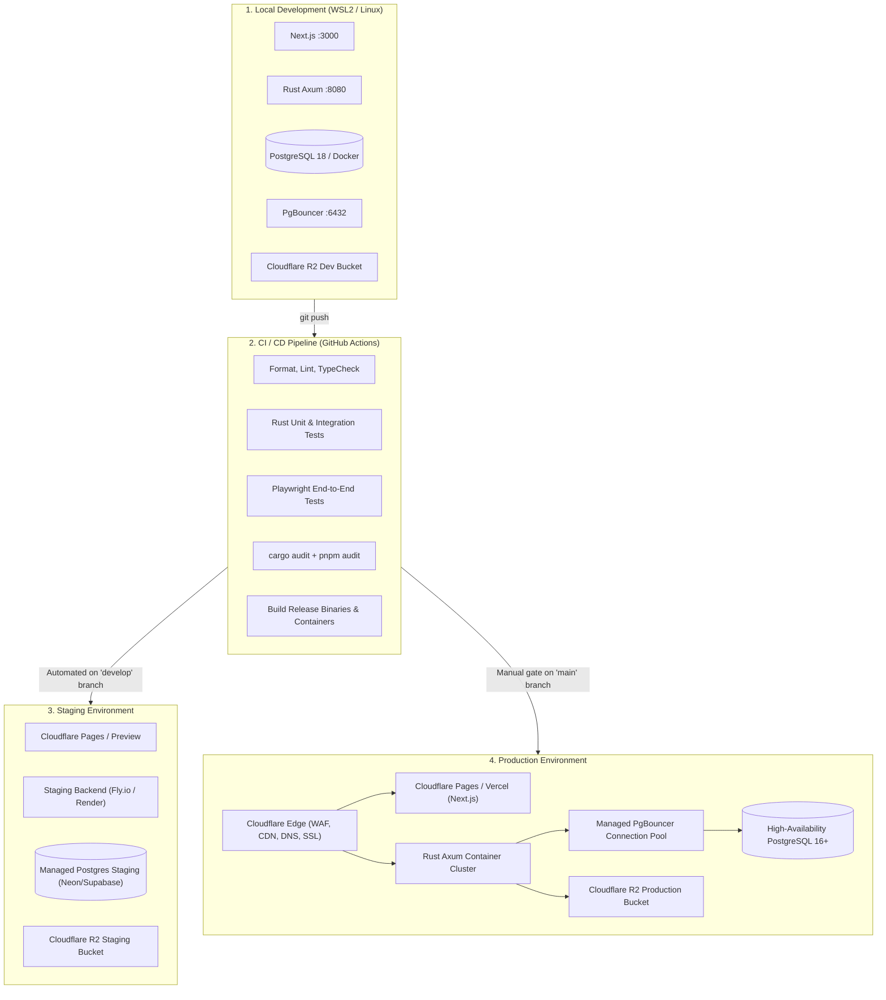
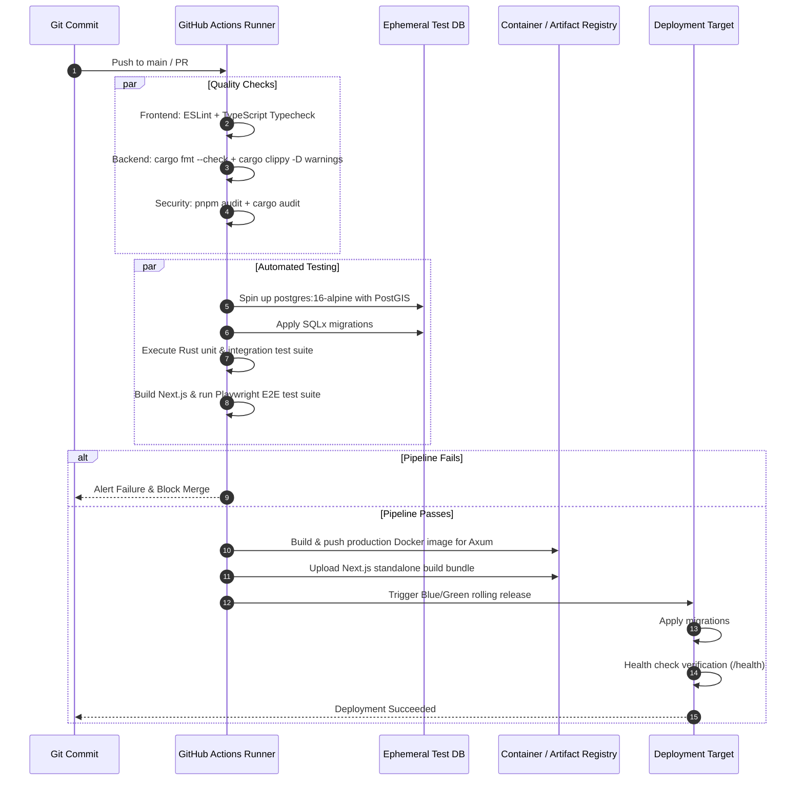

# OneTownCity — Migration & Deployment Strategy

> Version: 0.1.0 · Status: **Draft for Review** · Author: DevOps & Infrastructure · Date: 2026-10-20

---

## 1. Environment Topology

OneTownCity follows a three-tier environment model: Local Development, Staging (Verification), and Production.



---

## 2. Database Migration Lifecycle

### 2.1 State of Existing Migrations
The current initial migration file:
- `backend/migrations/20261020_000001_init.sql`

Contains a minimal stub creating `users` and `towns` tables with missing columns (no `password_hash`, no `citext`, no organisation relationships, no soft deletes). 

**Strategy:** Because this repository is in early development with no live production database, we will replace this initial stub migration with a clean, modular migration sequence corresponding to `docs/DATABASE_DESIGN.md`.

### 2.2 Standard Migration Sequence (Initial Baseline)
```
backend/migrations/
├── 20261020000001_core_extensions.sql       # uuid-ossp, postgis, citext, update triggers
├── 20261020000002_create_users.sql           # users table with authentication & roles
├── 20261020000003_create_organizations.sql   # organisations, org_memberships
├── 20261020000004_create_taxonomy.sql        # categories, towns
├── 20261020000005_create_businesses.sql      # business_profiles, business_categories, GIN/GIST indexes
├── 20261020000006_create_media.sql           # media_assets (R2 keys)
├── 20261020000007_create_enquiries.sql       # enquiries
├── 20261020000008_create_reviews.sql         # reviews, review_responses, rating materialized view
├── 20261020000009_create_subscriptions.sql   # subscriptions (Stripe tracking)
├── 20261020000010_create_analytics.sql       # analytics_events table
└── 20261020000011_create_audit_notify.sql    # audit_log (immutable), notifications
```

### 2.3 Zero-Downtime Migration Principles for Production
Once in production, all database schema modifications must adhere to the **Expand and Contract Pattern**:

1. **Phase 1: Expand (Additive Changes)**
   - New columns must be `NULL` or provide a default value.
   - New indexes must be built concurrently (`CREATE INDEX CONCURRENTLY`) to prevent blocking table writes.
   - Code is updated to write to both old and new columns, reading from old columns.
2. **Phase 2: Backfill**
   - Data migration jobs backfill data from old structures into new structures in batch increments.
3. **Phase 3: Switch Reads**
   - Code is deployed to read from the new columns/tables.
4. **Phase 4: Contract (Destructive / Cleanup)**
   - Once traffic has stabilized, old columns/tables are dropped in a subsequent release.

### 2.4 Migration Execution Workflow
- **Local:** Run via `sqlx migrate run` directly against local Postgres or Dockerized Postgres.
- **CI/CD:** Automated verification against a fresh, ephemeral PostgreSQL container service to guarantee migration idempotency and rollback safety.
- **Production:** Automated release phase step executed prior to traffic switching, with automatic rollback gates on failure.

---

## 3. Continuous Integration & Delivery Pipeline

### 3.1 Pipeline Stages in GitHub Actions



### 3.2 Automated Testing Matrix
- **Unit Tests:** Fast, isolated in-memory tests for business logic, pricing tier limits, and validation algorithms.
- **Integration Tests:** Axum route tests using `axum::test` and real PostgreSQL test database transactions rolled back after each test case.
- **End-to-End Tests:** Playwright driving browser sessions covering:
  - Discovery search, filter, and detail view.
  - Enquiry form submission & honeypot rejection.
  - Business owner registration, profile edit, and photo upload flow.

---

## 4. Production Deployment Architecture

### 4.1 Frontend Deployment (Next.js)
- **Target:** Cloudflare Pages (via Next-on-Pages / OpenNext) or Managed Node Container (Fly.io / Render / ECS).
- **Caching Strategy:**
  - Public directory pages: Edge cached with `Cache-Control: s-maxage=3600, stale-while-revalidate=86400`.
  - Invalidation: On-demand cache tagging (`revalidateTag`) triggered when a business profile updates.
  - Authenticated dashboard: `Cache-Control: no-store, private`.

### 4.2 Backend Deployment (Rust / Axum)
- **Containerization:** Multi-stage scratch/distroless Docker container for the Axum binary:
  - Build stage: `rust:1.80-alpine` with musl / cargo-chef for dependency caching.
  - Runtime stage: `alpine:3.20` or `distroless/cc-debian12` (~25MB image size).
- **Execution:** Run as non-root user (`appuser:10001`).
- **Resource Constraints:** Minimum 512MB RAM, 0.5 vCPU; scales horizontally behind a round-robin load balancer.
- **Graceful Shutdown:** Intercepts `SIGINT` / `SIGTERM`, drains in-flight HTTP requests within 30 seconds, and gracefully closes database pool connections.

### 4.3 Database & Pooling Architecture
- **Managed PostgreSQL (Postgres 16+):** Hosted on Supabase or Neon with automatic point-in-time backups (PITR).
- **Connection Pooler (PgBouncer):**
  - Pool mode: `transaction`
  - Max client connections: 200–500
  - Server pool size: 20–30 dedicated backend database connections.
  - Prevents connection exhaustion during sudden traffic spikes on public directory pages.

### 4.4 Object Storage & Assets (Cloudflare R2)
- Zero egress fees.
- Global CDN caching for verified media assets under `https://assets.onetowncity.com`.
- Lifecycle rules: Automatic abort of incomplete multipart uploads after 7 days; temp folder cleanups.

---

## 5. Monitoring, Observability & Incident Response

### 5.1 Telemetry Stack
1. **OpenTelemetry (OTel):**
   - Distributed trace propagation across Next.js frontend and Rust backend via `traceparent` headers.
   - Tracing spans around database queries, external Stripe calls, and R2 uploads.
2. **Sentry Error Tracking:**
   - Real-time notification of uncaught panics in Rust or React hydration/rendering exceptions.
   - PII scrubbing enabled to prevent customer emails or passwords from leaking into error logs.
3. **Structured Logging:**
   - JSON format across all environments with fields: `timestamp`, `level`, `span_id`, `trace_id`, `org_id`, `message`.

### 5.2 Health Checks & Uptime Probes
- `GET /health` endpoint checks:
  1. TCP listener health.
  2. Database connectivity (`SELECT 1`).
  3. Connection pool saturation (active vs idle connections).
- Cloudflare Health Monitors poll `/health` every 60 seconds; automatic failover if consecutive failures exceed threshold.

### 5.3 Disaster Recovery & Backups
- **RPO (Recovery Point Objective):** < 5 minutes via continuous WAL archiving (PITR).
- **RTO (Recovery Time Objective):** < 1 hour to provision an alternate database instance and restore from snapshot.
- **Media Assets:** R2 bucket cross-region replication enabled for catastrophic failure mitigation.
