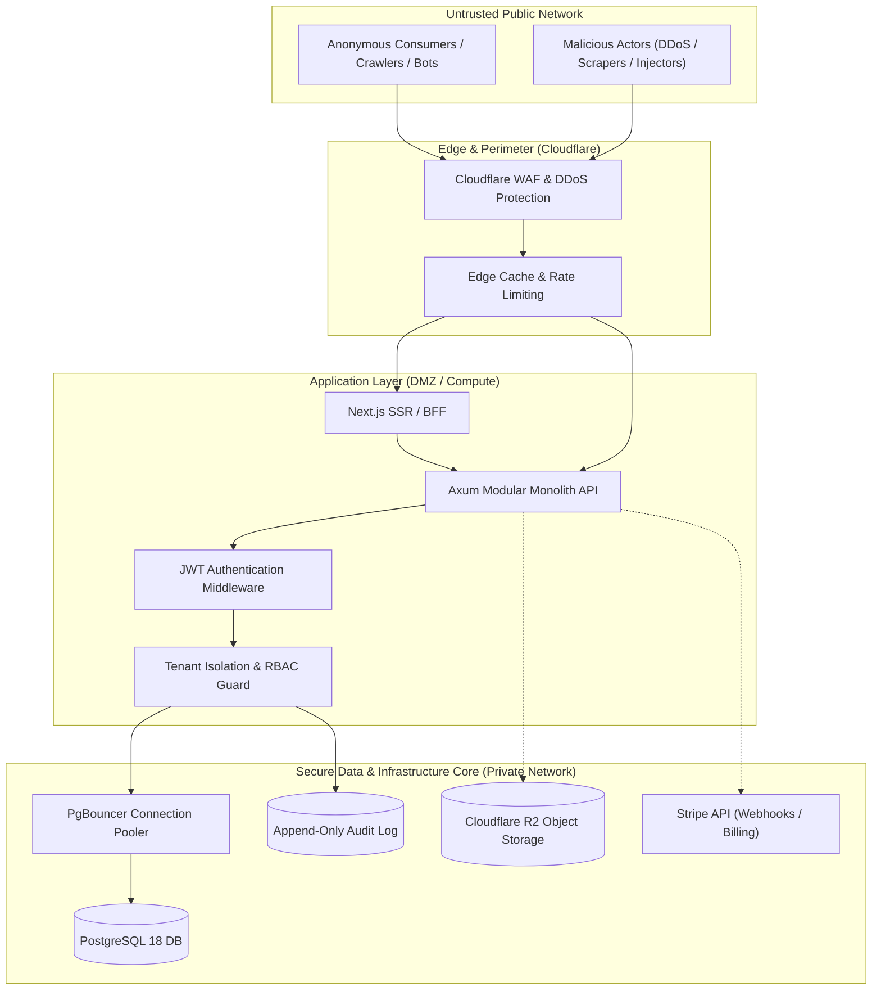
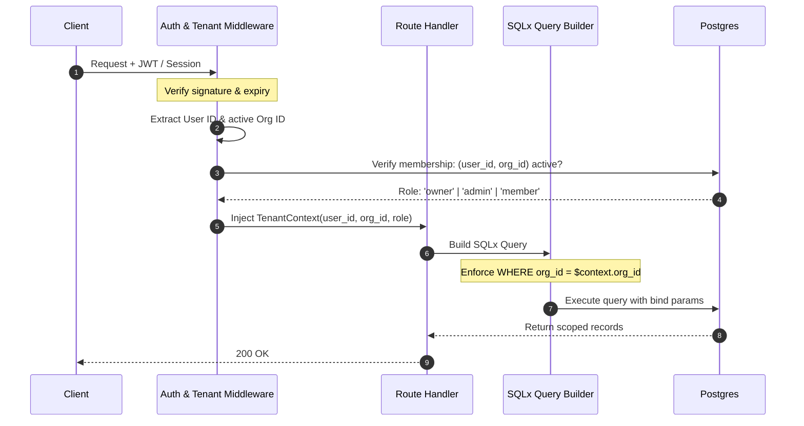
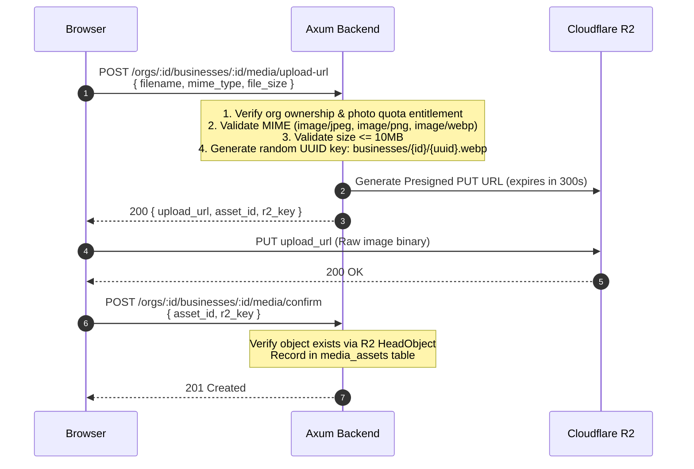

# OneTownCity — Security Model & Threat Architecture

> Version: 0.1.0 · Status: **Draft for Review** · Author: Security Engineering · Date: 2026-10-20

---

## 1. Threat Model & Trust Boundaries

OneTownCity operates across four distinct trust zones:



### Trust Boundary Rules
1. **Never trust client input:** All inputs (JSON payloads, path parameters, query strings, headers) are validated against strict Rust structs with `validator` before processing.
2. **Zero client-side authority:** UI controls, hidden buttons, or route guards in Next.js are usability features, never authorization boundaries.
3. **Strict tenant segregation:** An authenticated user can never query or manipulate data belonging to another organisation, even if they guess or know UUIDs.

---

## 2. Authentication & Credential Architecture

### 2.1 Password Hashing
- **Algorithm:** Argon2id (RFC 9106 recommended).
- **Parameters:**
  - Memory: 64 MiB ($m=65536$)
  - Iterations: 3 ($t=3$)
  - Parallelism: 2 ($p=2$)
- Plaintext passwords never touch database logs, error traces, or memory longer than the hashing function execution.

### 2.2 Token Strategy & Session Handling
- **Access Tokens:** Short-lived JSON Web Tokens (JWT), signed with `HMAC-SHA256` or `Ed25519`.
  - Expiry: 15–60 minutes.
  - Claims payload:
    ```json
    {
      "sub": "user_uuid",
      "org_id": "active_org_uuid",
      "system_role": "consumer | owner | admin",
      "org_role": "owner | admin | member",
      "iss": "onetowncity-api",
      "aud": "onetowncity-app",
      "exp": 1761012261,
      "iat": 1761008661
    }
    ```
- **Token Delivery Options:**
  - *Option A (Recommended for Web):* Secure, `HttpOnly`, `SameSite=Lax`, `Secure` cookies managed by Next.js BFF layer.
  - *Option B (Direct API):* `Authorization: Bearer <JWT>` header with structured refresh token mechanism stored in Postgres with device fingerprinting and revocation capabilities.

### 2.3 Account Protection & MFA
- Mandatory rate-limiting on `/auth/login` and `/auth/register` (max 5 failed attempts per IP/email tuple per 15 minutes before exponential backoff).
- Password complexity requirements: Minimum 12 characters, including mixed case, numbers, and symbols. Checked against common password breach dictionaries.
- MFA (TOTP - RFC 6238) planned for platform administrators and business owners handling billing.

---

## 3. Tenant Isolation & Authorization (RBAC)

### 3.1 The Tenancy Invariant
Every request touching business data must execute within the context of an established Organization ID (`org_id`).



### 3.2 Role-Based Access Matrix

| Capability | Public / Guest | Consumer | Org Member | Org Admin | Org Owner | Platform Admin |
|------------|:--------------:|:--------:|:----------:|:---------:|:---------:|:--------------:|
| Browse directory & view profiles | ✅ | ✅ | ✅ | ✅ | ✅ | ✅ |
| Send business enquiry | ✅ (rate limited) | ✅ | ✅ | ✅ | ✅ | ✅ |
| Write business review | ❌ | ✅ (verified) | ❌ (conflict of interest) | ❌ | ❌ | ❌ |
| View organization inbox / leads | ❌ | ❌ | ✅ (own org) | ✅ (own org) | ✅ (own org) | ✅ (audit logged) |
| Reply to reviews / enquiries | ❌ | ❌ | ✅ (own org) | ✅ (own org) | ✅ (own org) | ❌ |
| Edit business profile / media | ❌ | ❌ | ❌ | ✅ (own org) | ✅ (own org) | ✅ (supervisory) |
| Manage team members & invites | ❌ | ❌ | ❌ | ❌ | ✅ (own org) | ❌ |
| Upgrade / cancel subscription | ❌ | ❌ | ❌ | ❌ | ✅ (own org) | ❌ |
| Moderate reviews & verify businesses | ❌ | ❌ | ❌ | ❌ | ❌ | ✅ |
| Access system audit logs | ❌ | ❌ | ❌ | ❌ | ❌ | ✅ |

### 3.3 Defense-in-Depth Against IDOR (Insecure Direct Object References)
- Handlers never accept an unvalidated `org_id` from client payloads or route path variables without checking membership against the token.
- SQL queries parameterized using SQLx compile-time checks (`sqlx::query!`).
- Optional PostgreSQL Row-Level Security (RLS) can be layered as a second containment boundary if desired in later phases.

---

## 4. Input Validation, Storage & Media Security

### 4.1 Injection Mitigation
- **SQL Injection:** 100% prohibited use of string concatenation or raw interpolation in SQL. All queries must use SQLx parameterized bindings (`$1, $2, ...`).
- **XSS (Cross-Site Scripting):**
  - Next.js React JSX automatically escapes output strings.
  - Strict Content Security Policy (CSP) deployed via HTTP response headers:
    ```http
    Content-Security-Policy: default-src 'self'; script-src 'self' 'unsafe-eval' 'unsafe-inline'; style-src 'self' 'unsafe-inline'; img-src 'self' blob: data: https://pub-*.r2.dev https://*.r2.cloudflarestorage.com; font-src 'self'; object-src 'none'; connect-src 'self' http://localhost:8080 https://sentry.io;
    ```
- **Header Hardening:**
  - `X-Content-Type-Options: nosniff`
  - `X-Frame-Options: DENY`
  - `Referrer-Policy: strict-origin-when-cross-origin`
  - `Permissions-Policy: camera=(), microphone=(), geolocation=()`

### 4.2 Cloudflare R2 Upload Flow & Media Sanitization
Direct media uploads through the backend server create bandwidth bottlenecks and buffer exhaustion vectors. OneTownCity implements **Signed Pre-Signed Upload URLs**:



**Upload Security Constraints:**
- Pre-signed URLs restricted to `PUT` with exact `Content-Type` and 5-minute expiry.
- Storage keys generated purely as cryptographically random UUIDs (`media/{uuid}.ext`) to prevent path traversal (`../../`).
- SVG uploads strictly rejected to eliminate Stored XSS vectors unless converted to raster images.

---

## 5. Rate Limiting, Abuse Prevention & Spam Mitigation

### 5.1 Layered Rate Limiting
1. **Cloudflare Edge:**
   - Global DDoS mitigation.
   - WAF rules for automated credential stuffing and scraping bots.
2. **Axum Application Middleware:**
   - Implemented via `governor` or token-bucket in memory/database:
     - Public search/browse: 120 req/min per IP.
     - Authentication (`/auth/*`): 10 req/min per IP.
     - Enquiry submission (`POST /enquiries`): 5 req/hour per IP.
     - Review submission (`POST /reviews`): 3 req/day per user.

### 5.2 Enquiry Form Spam Protection
- **Honeypot field:** Hidden form field (`website_url_hp`) invisible to human users via CSS. Submissions containing content in this field are silently dropped or rejected with HTTP 200/400.
- **Time-to-submit verification:** Submissions occurring less than 3 seconds after page render are flagged as automated bot scripts.
- **Disposable email detection:** Optional blocklist check against known temporary email domains for anonymous enquiries.

---

## 6. Data Privacy, Compliance & GDPR

### 6.1 Data Categorization
| Category | Examples | Retention Policy | Protection Mechanism |
|----------|----------|------------------|----------------------|
| **Account PII** | User email, name, password hash | Account lifetime + 30 days after deletion | Hashed/Restricted access |
| **Business Contact PII** | Owner phone, email, registered address | Active listing duration | Public profile display with consent |
| **Enquiry Data** | Consumer name, email, phone, message | 180 days (configurable by owner) | Scoped to business tenant |
| **Telemetry / Logs** | IPs, User-Agents in analytics | Hashed server-side (HMAC); raw logs 14 days | Anonymized session IDs |
| **Audit Logs** | Admin actions, role changes, verification | 2 years | Append-only, immutable |

### 6.2 GDPR Rights Implementation
1. **Right of Access & Portability (Art. 15 & 20):**
   - Self-service "Export My Data" generating a machine-readable JSON archive containing user profile, owned businesses, submitted enquiries, and reviews.
2. **Right to Erasure ("Forgot to be Forgotten" - Art. 17):**
   - Soft-delete triggered immediately upon user confirmation.
   - Hard purge after 30-day recovery window: PII columns cleared (`name = 'Deleted User'`, `email = 'anon_uuid@deleted.onetowncity.com'`), business associations dissociated or reassigned.

---

## 7. Audit Logging & Administrative Integrity

### 7.1 Immutability of the Audit Trail
- The `audit_log` table in PostgreSQL has restricted `GRANT` permissions: the application database user can `INSERT` and `SELECT`, but `UPDATE` and `DELETE` privileges are strictly revoked at the database role level.
- Any administrative intervention (listing suspension, review deletion, role escalation, plan overrides) requires an explicit reason stored in the audit record.

### 7.2 Administrative Impersonation Controls
- Impersonation is only allowed with active, time-bounded admin session tokens.
- All requests executed under impersonation carry an `X-Impersonated-By: <admin_uuid>` trace recorded in telemetry and audit logs.
- High-risk operations (changing billing accounts, deleting businesses, modifying passwords) are blocked during impersonated sessions.

---

## 8. Secrets Management & Operational Security

### 8.1 Secret Handling Rules
- Zero secrets committed to git repositories (`.env` strictly git-ignored).
- Development environments use distinct, dummy credentials from staging/production.
- Automated secret scanning enabled in GitHub Actions (`gitleaks` / `trufflehog`).

### 8.2 Inventory of Secrets & Rotation Procedures
| Secret Name | Purpose | Target Store | Rotation Interval |
|-------------|---------|--------------|-------------------|
| `DATABASE_URL` | Postgres credentials | Kubernetes / Fly Secret / Env | 90 days / On breach |
| `JWT_SECRET` | Token signing | Secure Key Vault / Env | 180 days (with dual-key grace window) |
| `AWS_SECRET_ACCESS_KEY` | Cloudflare R2 access | Cloudflare Dashboard / Env | 90 days |
| `STRIPE_SECRET_KEY` | Payment API | Stripe Dashboard / Env | On rotation policy |
| `STRIPE_WEBHOOK_SECRET` | Webhook verification | Stripe Dashboard / Env | On rotation policy |
| `SENTRY_DSN` | Error telemetry | Ingest token (public/safe) | As needed |
