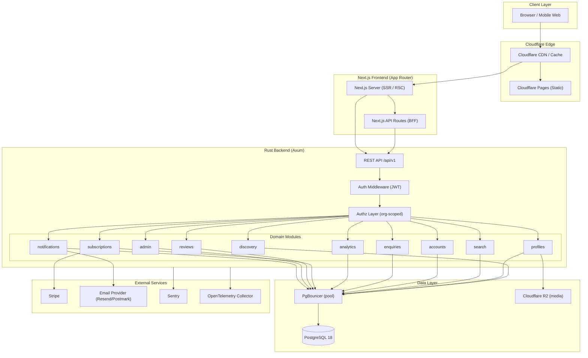
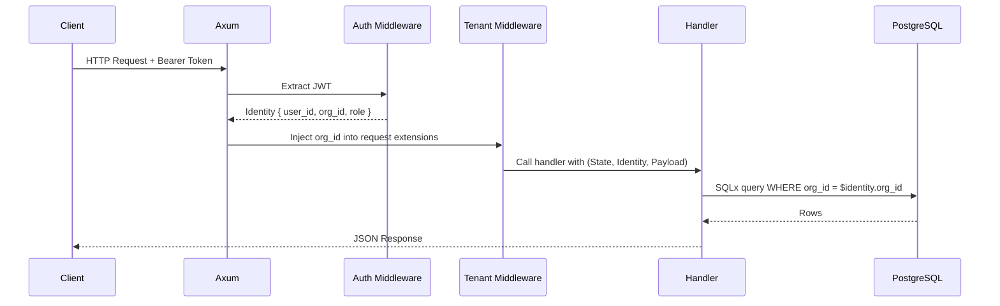
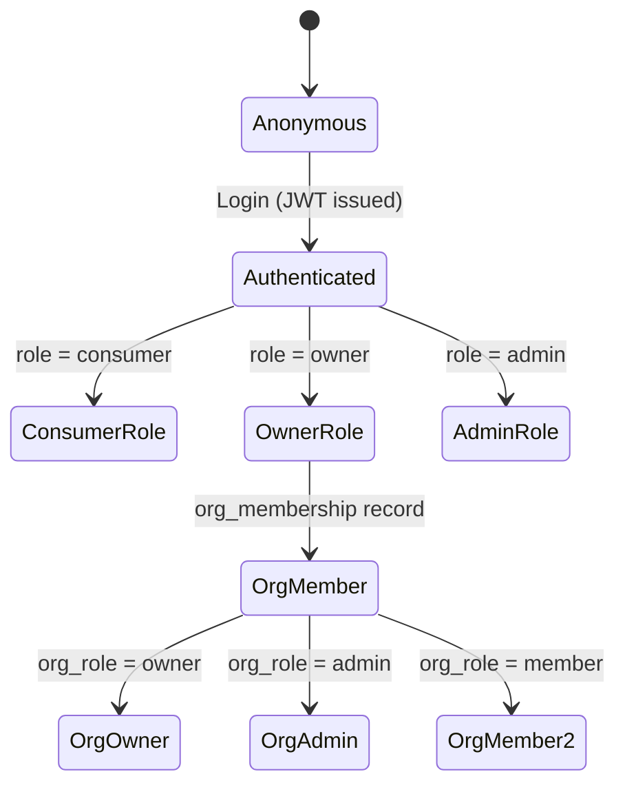

# OneTownCity — System Architecture

> Version: 0.1.0 · Status: **Draft for Review** · Date: 2026-10-20

---

## 1. Architecture Decision: Modular Monolith

OneTownCity uses a **modular monolith** — a single deployable unit with clearly enforced internal module boundaries. This is a deliberate choice for the current stage:

- **No microservices** until a concrete scalability or team-ownership bottleneck is identified and measured.
- **No Redis, separate search cluster, or message broker** until query volume or latency requirements cannot be met by PostgreSQL alone.
- All modules communicate via Rust function calls (not HTTP), keeping latency minimal and simplifying operational overhead.
- Boundaries are enforced via Rust module visibility rules (`pub(crate)`, restricted `pub use`), not network calls.

---

## 2. High-Level Architecture



---

## 3. Frontend Architecture

### Technology Stack

| Layer | Technology | Version |
|-------|-----------|---------|
| Framework | Next.js App Router | 16.4.2 |
| Runtime | React | 19.3.0 |
| Language | TypeScript | 5.9.3 |
| Styling | Tailwind CSS | 4.x |
| Component library | shadcn/ui (to be added) | latest |
| Testing | Vitest + Playwright | TBD |
| Observability | Sentry + OpenTelemetry | installed |

### App Router Structure (Proposed)

```
frontend/src/
├── app/
│   ├── layout.tsx                        # Root layout (fonts, global providers)
│   ├── page.tsx                          # Home / landing page
│   ├── (discovery)/                      # Route group: public directory
│   │   ├── [city]/
│   │   │   ├── page.tsx                  # City business listing
│   │   │   └── [category]/
│   │   │       ├── page.tsx              # Category listing within city
│   │   │       └── [slug]/
│   │   │           └── page.tsx          # Individual business profile page
│   ├── search/
│   │   └── page.tsx                      # Search results
│   ├── (auth)/                           # Route group: authentication
│   │   ├── login/page.tsx
│   │   ├── register/page.tsx
│   │   └── verify/page.tsx
│   ├── dashboard/                        # Business owner dashboard (protected)
│   │   ├── layout.tsx                    # Dashboard shell (sidebar, auth guard)
│   │   ├── page.tsx                      # Dashboard home / overview
│   │   ├── profile/page.tsx             # Edit business profile
│   │   ├── enquiries/page.tsx           # Enquiry inbox
│   │   ├── analytics/page.tsx           # Analytics
│   │   ├── reviews/page.tsx             # Reviews
│   │   └── billing/page.tsx             # Subscription management
│   └── admin/                            # Admin panel (admin role only)
│       ├── layout.tsx
│       ├── page.tsx
│       ├── listings/page.tsx
│       ├── categories/page.tsx
│       └── moderation/page.tsx
├── components/
│   ├── ui/                               # shadcn/ui primitives
│   ├── discovery/                        # BusinessCard, CategoryBadge, StarRating
│   ├── dashboard/                        # DashboardNav, EnquiryRow, AnalyticsChart
│   └── shared/                           # Header, Footer, SearchBar
├── lib/
│   ├── api.ts                            # Typed API client (fetch wrapper)
│   ├── auth.ts                           # Auth helpers / session utilities
│   └── utils.ts                          # Shared utilities
└── types/
    └── api.ts                            # Shared TypeScript types (mirrored from API contract)
```

### Rendering Strategy

| Page type | Strategy | Reason |
|-----------|----------|--------|
| Business directory / listing pages | SSR with Cloudflare Cache (stale-while-revalidate) | SEO + performance |
| Business detail page | SSR + ISR (revalidate on profile update) | SEO + freshness |
| Search results | SSR with short cache TTL | Dynamic queries |
| Dashboard pages | CSR / React Server Components (no cache) | Auth-gated, real-time |
| Auth pages | CSR | Client-side form logic |
| Admin pages | CSR | Internal tool |

---

## 4. Backend Architecture

### Technology Stack

| Layer | Technology | Version |
|-------|-----------|---------|
| Language | Rust | 1.99.1 (stable) |
| Web framework | Axum | 0.8 |
| Async runtime | Tokio | 1.x |
| Database access | SQLx | 0.8 |
| Connection pool | PgBouncer → SQLx PgPool | — |
| Validation | validator | 0.19 |
| Auth tokens | JWT (jsonwebtoken crate — to add) | — |
| Password hashing | argon2 (to add) | — |
| HTTP client | reqwest (rustls-tls) | 0.12 |
| Observability | tracing + OTel + Sentry | installed |

### Module Structure (Proposed)

```
backend/src/
├── main.rs                    # Server bootstrap, router assembly, graceful shutdown
├── config.rs                  # Configuration struct (from env vars)
├── error.rs                   # AppError enum + IntoResponse
├── db.rs                      # Pool creation, extension setup
├── middleware/
│   ├── auth.rs                # JWT extraction + identity injection
│   ├── tenant.rs              # Org-scoped context injection
│   └── rate_limit.rs          # Token-bucket rate limiting
├── modules/
│   ├── discovery/             # Module 1
│   │   ├── mod.rs             # routes(), pub API
│   │   ├── handlers.rs
│   │   ├── queries.rs         # SQLx queries (compile-time checked)
│   │   └── models.rs          # Serde-serialisable response types
│   ├── profiles/              # Module 2
│   ├── search/                # Module 3
│   ├── accounts/              # Module 4 (auth + orgs)
│   │   ├── auth.rs            # Login, register, JWT issuance
│   │   └── orgs.rs            # Org CRUD, membership, invites
│   ├── enquiries/             # Module 5
│   ├── analytics/             # Module 6
│   ├── subscriptions/         # Module 7 + Stripe webhooks
│   ├── reviews/               # Module 8
│   ├── admin/                 # Module 9
│   └── notifications/         # Module 10 (email dispatch, in-app)
└── routes.rs                  # Top-level router — mounts all module routers
```

### Request Lifecycle



### Authorization Model



**Rules:**
1. Every handler that accesses organisation data MUST receive `org_id` from the verified JWT — never from a query parameter.
2. All SQLx queries on org-scoped tables include `WHERE org_id = $1` with the injected value.
3. Admin endpoints are in a separate router mounted under `/api/v1/admin`, protected by a middleware that checks `role = admin`.
4. UI hiding is not authorization. Entitlement checks are in the handler layer, not the frontend.

---

## 5. Data Layer

### PostgreSQL

- Version: 18.6 (local dev), targeting PostgreSQL 16+ in production (Supabase or Neon recommended).
- Extensions required: `uuid-ossp`, `postgis` (proximity search), `pg_trgm` (fuzzy text search).
- Migrations managed by SQLx CLI (`sqlx migrate run`).
- Full-text search: `tsvector` generated columns + `GIN` indexes.
- Connection pooling: PgBouncer in **transaction mode** (required for SQLx compatibility).

### Cloudflare R2

- Used for: business photos, logo, cover image, user-uploaded documents (verification).
- Access: Rust backend generates pre-signed PUT URLs; client uploads directly to R2.
- CDN delivery: Cloudflare public bucket or R2 custom domain for fast global delivery.
- Integration: AWS SDK v4 signature (R2 is S3-compatible). `reqwest` + manual signing, or `aws-sdk-s3` crate.

---

## 6. Infrastructure and Deployment

```mermaid
graph LR
    subgraph Dev["Development (Local WSL2)"]
        DEV_FE["Next.js :3000"]
        DEV_BE["Rust Axum :8080"]
        DEV_DB["Postgres :5432 (local)"]
        DEV_PGB["PgBouncer :6432 (Docker)"]
    end

    subgraph CI["GitHub Actions CI"]
        CI_FE["Frontend: lint, typecheck, build"]
        CI_BE["Backend: clippy, test, release build"]
        CI_AUDIT["cargo audit + pnpm audit"]
    end

    subgraph Prod["Production (target)"]
        CF_PAGES["Cloudflare Pages (Next.js frontend)"]
        FLY["Fly.io or Render (Rust backend)"]
        NEON["Neon or Supabase (PostgreSQL)"]
        R2_PROD["Cloudflare R2 (media)"]
        STRIPE_PROD["Stripe (subscriptions)"]
    end

    Dev --> CI
    CI --> Prod
```



**Current state:** Local development only. No production deployment exists. CI pipeline is defined in `.github/workflows/ci.yml` but has not been run against a real repository.

---

## 7. What Exists vs. What Needs Building

### Existing (Keep / Reuse)

| File | Status | Action |
|------|--------|--------|
| `backend/src/main.rs` | Good skeleton | **Keep** — server bootstrap, OTel, Sentry, graceful shutdown |
| `backend/src/error.rs` | Good pattern | **Keep** — extend with new error variants |
| `backend/src/routes.rs` | Stub only | **Extend** — add all module routes |
| `backend/Cargo.toml` | Good base | **Extend** — add argon2, jsonwebtoken, aws-sdk-s3, stripe crates |
| `backend/migrations/20261020_000001_init.sql` | **Incomplete** | **Rebuild** — `users` and `towns` tables are too thin; full schema needed |
| `frontend/next.config.ts` | Good | **Keep** — security headers, image domains, proxy rewrite |
| `frontend/instrumentation.ts` | Good | **Keep** — OTel + Sentry init |
| `.github/workflows/ci.yml` | Good | **Keep and extend** — add Playwright e2e job |
| `docker-compose.yml` | Good | **Keep** — Postgres + PgBouncer for local dev |

### Needs Building (Not Yet Implemented)

| Area | Status |
|------|--------|
| All 10 domain modules (handlers, queries, models) | ❌ Not started |
| Authentication (JWT, argon2, session management) | ❌ Not started |
| Organisation / multi-tenancy | ❌ Not started |
| Full database schema | ❌ Not started (only `users` + `towns` stub) |
| Frontend routing and pages | ❌ Default Next.js placeholder only |
| shadcn/ui component library | ❌ Not installed |
| Stripe integration | ❌ Not started |
| Cloudflare R2 upload flow | ❌ Not started |
| Email notification system | ❌ Not started |
| Playwright e2e tests | ❌ Not started |
| Full-text search indexes | ❌ Not started |
| Admin panel | ❌ Not started |

---

## 8. Technology Gaps and Risks

| Risk | Severity | Mitigation |
|------|----------|-----------|
| PostGIS extension not available on all managed Postgres providers | Medium | Verify with chosen provider (Neon supports PostGIS); fallback to bounding-box proximity query |
| `pnpm create next-app` generated v16.4.2 — verify stability | Low | Keep locked; upgrade after milestone 2 |
| OTel SDK v2 breaking API changes (Resource export pattern) | Low | Documented and patched; maintain in-code comment |
| No authentication system yet — must be added before any protected endpoint | High | Milestone 1 priority |
| Stripe webhook security (signature verification) must be implemented | High | Use `stripe-rust` or manual HMAC verification |
| GDPR compliance not designed yet | Medium | Q8 in PRD must be resolved before launch |
| No test coverage yet | High | Add tests module-by-module, starting with accounts |
